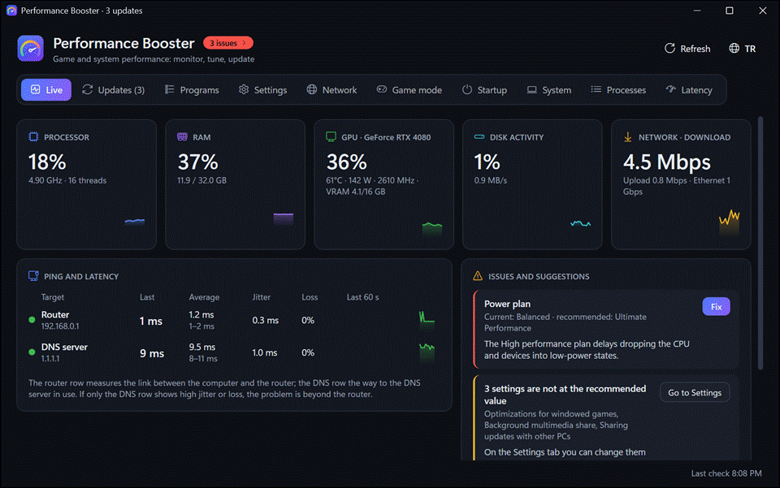
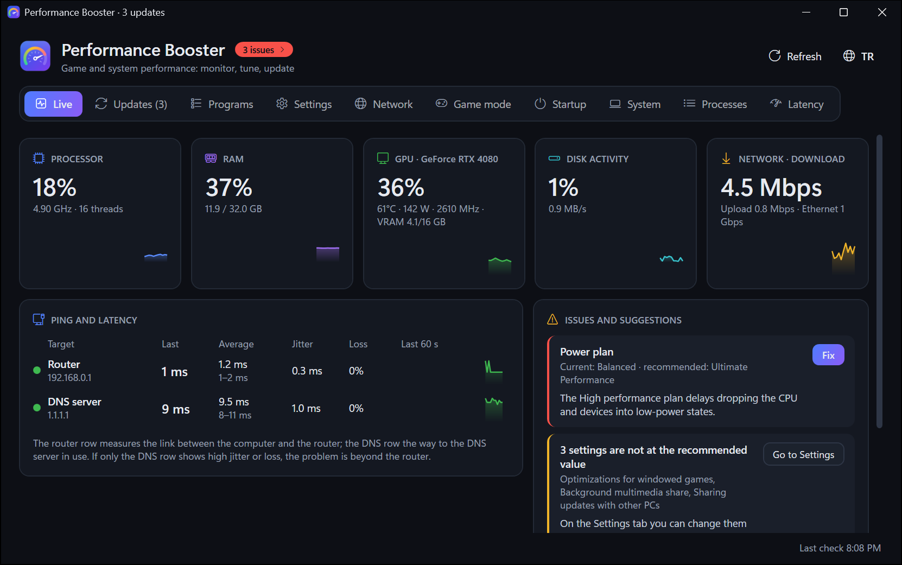
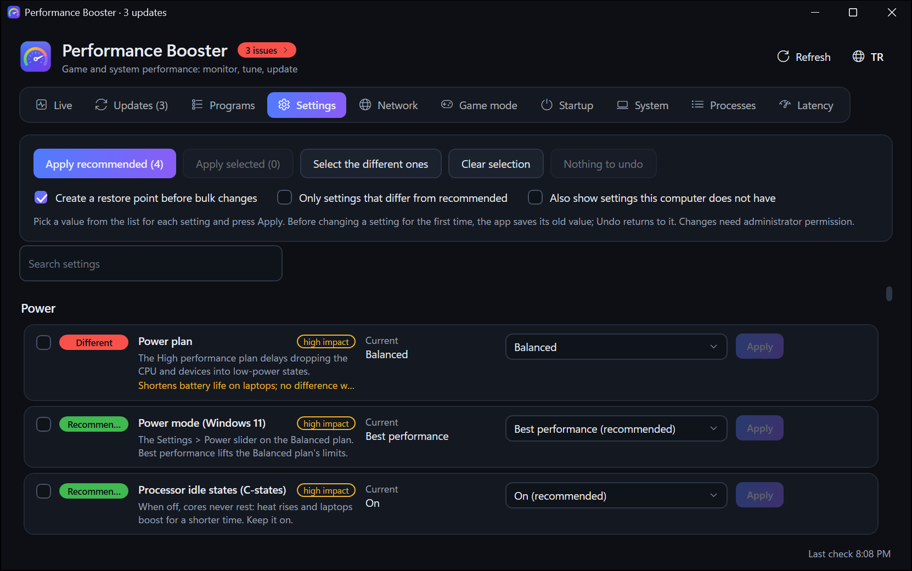
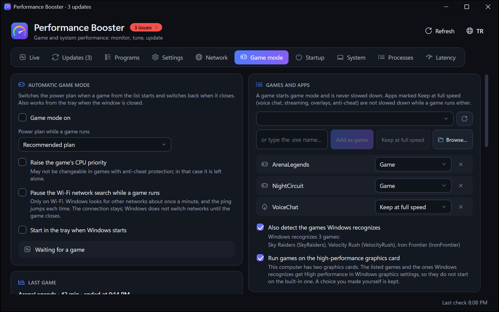
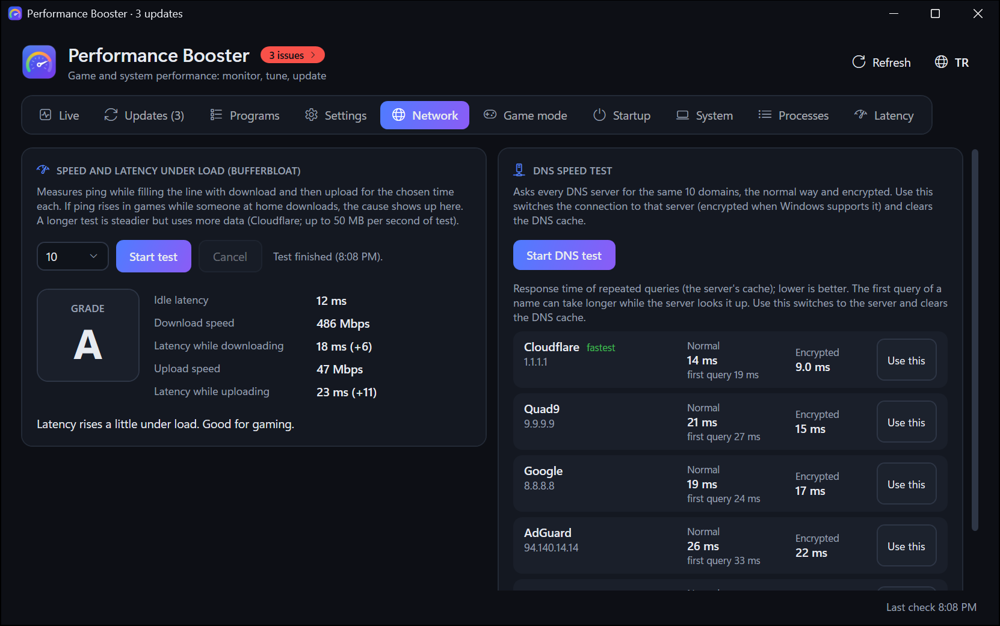
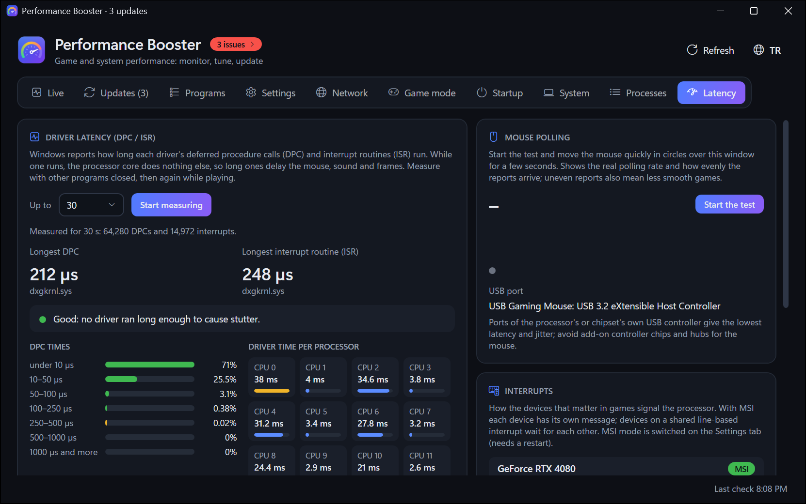
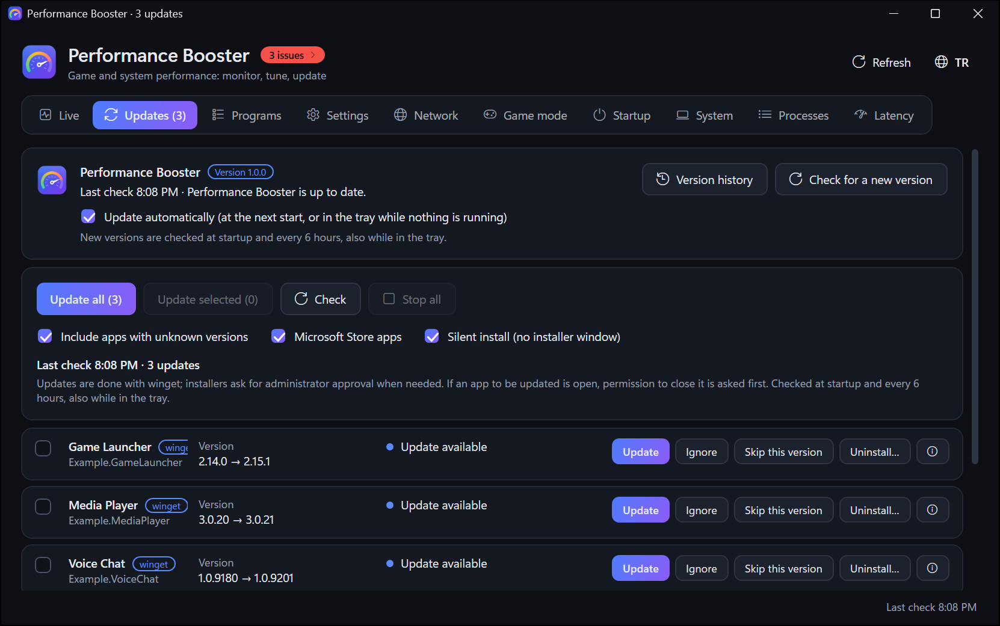
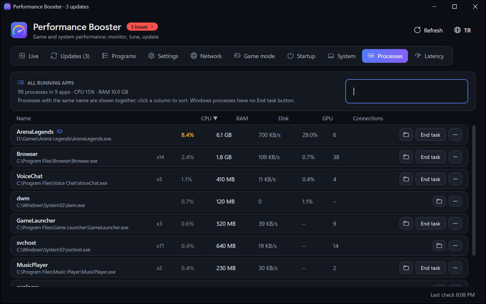
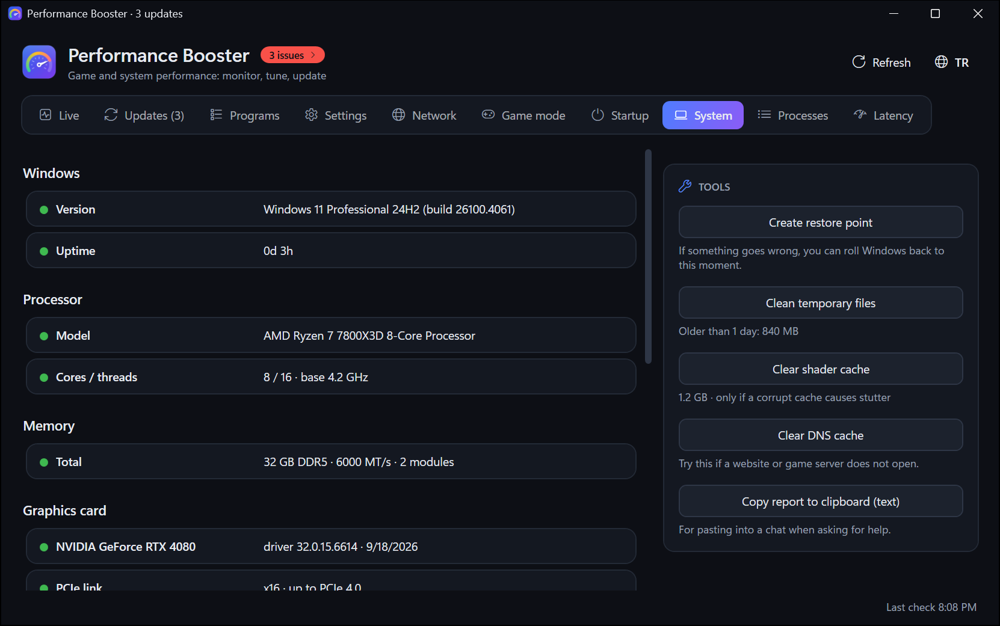

<div align="center">


# Performance Booster

**Game and system performance for Windows: monitor, tune, update.**

[](#requirements)
[](#download)
[](#languages)

<a href="https://github.com/AtaolB/Performance-Booster/releases/latest/download/PerformanceBooster.exe"></a>

<sub>One file · updates itself · [all versions](https://github.com/AtaolB/Performance-Booster/releases) · [what's new](CHANGELOG.md)</sub>

**English** · [Türkçe](README.tr.md)

<br>



</div>

## Why Performance Booster

- **One window for everything** that affects how games run: live usage, Windows settings, drivers and app updates, network quality, input latency.
- **Every change can be undone.** Before a setting is changed for the first time, its old value is saved; Undo puts it back. Bulk changes start with a restore point.
- **Explains instead of guessing.** Each setting says what it does, what it costs and what the recommended value is; issues come with a Fix button.
- **Small.** A single ~2 MB exe that keeps itself up to date.

## Features

| | |
|---|---|
| **Live** | An overview: CPU, RAM, graphics card, disk and network with 60-second charts; ping, jitter and loss to the router and to the DNS server in use; an issues panel with fixes (the issue count in the header opens it). Click a card to see the apps that use that resource most, including per-app network traffic. |
| **Processes** | Every running app with CPU, RAM, disk, graphics card and connections; click a column to sort, search or end the task. Right-click a row (or ⋯) to change its priority, add it to the game list, keep it at full speed while a game runs or open its file location. |
| **Updates** | App updates through winget (pin, skip a version, details); running apps are closed only with your permission. Cancel updates one by one or all at once. Driver updates through Windows Update; Check looks for both. |
| **Programs** | Desktop programs and Store apps with size, install date and last use; click a column to sort. Silent uninstall when possible, a scan for leftovers (files go to the Recycle Bin, registry keys are backed up first), and removal of broken entries whose files are already gone. |
| **Settings** | Power, graphics, scheduling, memory, input, network and network adapter settings, NVIDIA driver options, MSI mode, device power saving, unused devices and rarely needed services. Each one with its current and recommended value, impact and undo; hover a row for its full description, or find one with the search box. |
| **Game mode** | While a game runs (one from your list, added from the running apps or its exe file, or one Windows itself recognizes as a game): a power plan for games, optional higher priority for the game, other apps on low priority and efficiency mode and off the game's cores (except the apps you keep at full speed), the standby list emptied when memory runs low, Wi-Fi network search paused. With two graphics cards, games run on the high-performance one. After each game, the Last game card shows what held it back: heat or power limits, full video memory, low RAM or battery power. Your games can be excluded from Defender's real-time scanning. A finer Windows timer is held while the app runs. |
| **Latency** | Driver latency (DPC and ISR times per driver and per processor core), a mouse polling test with the USB controller the mouse is on, and the interrupts of the devices that matter in games. |
| **Network** | Speed test of 10, 30 or 60 seconds with latency under load (bufferbloat grade) and a DNS speed test, the normal way and encrypted (DNS over HTTPS), that also spots DNS redirection by the provider; switch to a faster DNS server with one click, encrypted on Windows 11. |
| **Startup · System** | Startup items, hardware details with hints (PCIe lanes of the graphics card, Resizable BAR, games on an HDD or a nearly full drive) and cleanup tools. |

<details>
<summary><b>Screenshots</b></summary>
<br>

| Live | Settings |
|---|---|
|  |  |
| **Game mode** | **Network** |
|  |  |
| **Latency** | **Updates** |
|  |  |
| **Processes** | **System** |
|  |  |

</details>

## Download

1. Download **[PerformanceBooster.exe](https://github.com/AtaolB/Performance-Booster/releases/latest/download/PerformanceBooster.exe)** from the latest release and put it in a folder of your own (for example `Documents\PerformanceBooster`).
2. Start it. Windows asks for administrator permission once: the app changes system settings, services and devices.
3. The **Live** tab shows what is going on right now; the **Settings** tab lists every setting with its recommended value.

New versions install themselves (at the next start, or while the app waits in the tray). After an update, the app shows what changed.

### Requirements

- Windows 10 version 1903 or later, or Windows 11 (64-bit).

### Languages

English and Turkish. The app follows the Windows display language and can be switched with the language button.

## Safety and privacy

- **Undo:** every setting keeps its original value; the Settings tab undoes one or all changes. Bulk changes create a restore point first.
- **Nothing is deleted for good:** leftover files go to the Recycle Bin, registry keys are exported to `.reg` files before removal.
- **No accounts, no telemetry.** The app connects only for what you see: update checks (GitHub, winget, Windows Update), ping targets on the Live tab, and the speed and DNS tests when you start them.
- **Your data stays local** in `%LOCALAPPDATA%\PerformanceBooster`.

## FAQ

<details>
<summary><b>Windows says "Windows protected your PC". Is it safe?</b></summary>

The exe is not code-signed, so SmartScreen does not know it yet. Click **More info → Run anyway**. Each release page shows the SHA-256 of the exe if you want to compare.
</details>

<details>
<summary><b>Why does it need administrator rights?</b></summary>

Power plans, services, devices, drivers and most game settings can only be changed by an administrator. The app runs as administrator so it does not ask for every single change.
</details>

<details>
<summary><b>How do I undo everything?</b></summary>

Settings tab → **Undo all**. You can also undo one setting at a time, or go back to the restore point created before bulk changes (System tab → Create restore point / Windows System Restore).
</details>

<details>
<summary><b>How do updates work?</b></summary>

The app checks for a new version at startup and every 6 hours and downloads it in the background. It is installed at the next start, when you click **Restart and update**, or while the app waits in the tray with nothing running. Turn it off on the Updates tab if you prefer to update by hand.
</details>

<details>
<summary><b>How do I remove the app?</b></summary>

First turn off **Start in the tray when Windows starts** and **RAM cleaning** on the Game mode tab (both use scheduled tasks), undo the settings you want back, then delete the exe and the `%LOCALAPPDATA%\PerformanceBooster` folder.
</details>

## Version history

Every version and what it brought: [CHANGELOG.md](CHANGELOG.md).

---

## For developers

<details>
<summary><b>Build, test, release</b></summary>
<br>

Requirements: Windows 10/11 and the [.NET 10 SDK](https://dotnet.microsoft.com/download).

```powershell
dotnet build PerformanceBooster.slnx -c Debug
dotnet run --project PerformanceBooster.Tests -- [--no-net] [--only Section]
dotnet publish PerformanceBooster.Launcher -c Release -o out   # out\PerformanceBooster.exe, runs as administrator
```

`dotnet publish PerformanceBooster.Launcher` builds the released exe; the app is packed inside it. The release workflow adds `-p:PublishAot=true` (needs the C++ build tools of Visual Studio).

Test sections: Localization, Engine, Updates, AppUpdate, Changelog, System, GameBoost, Latency, Network, Programs, Details, App. Tests never change real system settings: they use fake stores, temporary registry keys under `HKCU\Software\PerformanceBoosterTests`, temporary folders and fake processes. `PERFORMANCEBOOSTER_DATA` points the app at a separate data folder.

**Releasing:** every change that reaches `main` raises `<Version>` in `PerformanceBooster/PerformanceBooster.csproj` and adds its notes at the top of both [CHANGELOG.md](CHANGELOG.md) and [CHANGELOG.tr.md](CHANGELOG.tr.md) (the Changelog tests check this). When a version without a release reaches `main`, [the release workflow](.github/workflows/release.yml) runs the tests, builds the exe and publishes `v<version>` with those notes. Running copies find it and update themselves.

| Path | Contents |
|---|---|
| `PerformanceBooster/Core` | Settings engine, samplers, winget, Windows Update, programs, uninstaller, network tests, latency trace, self-update, version notes |
| `PerformanceBooster/UI` | View models, rows, dialogs, tray |
| `PerformanceBooster/Languages` | UI languages (`en.json`, `tr.json`), embedded in the exe; the English text in the code is the key |
| `PerformanceBooster.Launcher` | The released exe, with the app packed inside |
| `PerformanceBooster.Tests` | Test runner |
| `docs` | Screenshots and the tour animation |

</details>
