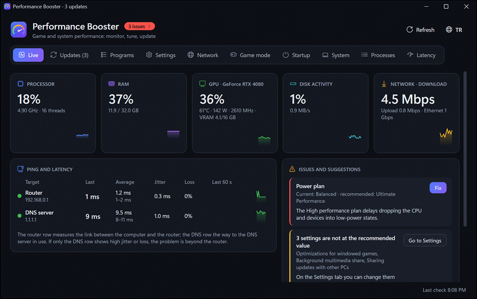
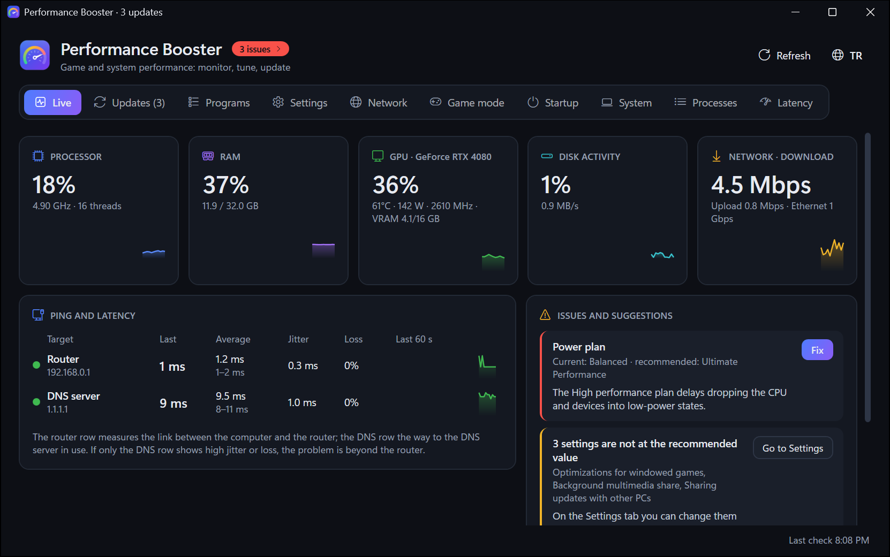
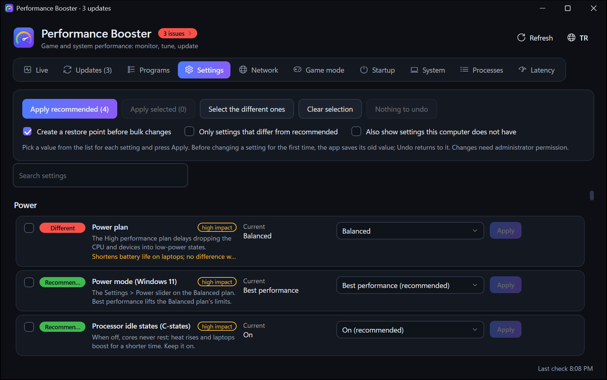
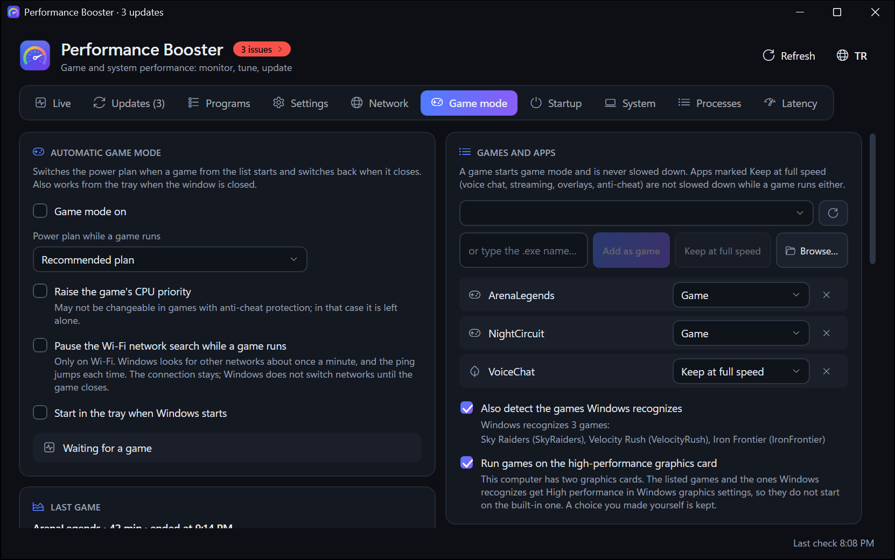
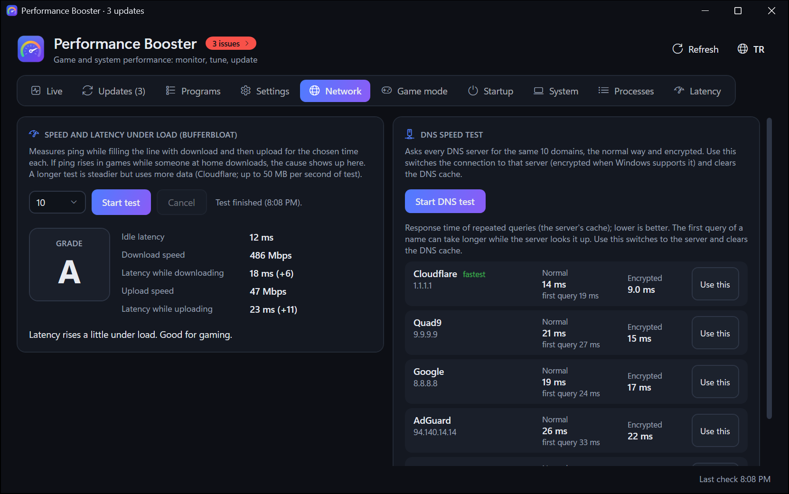
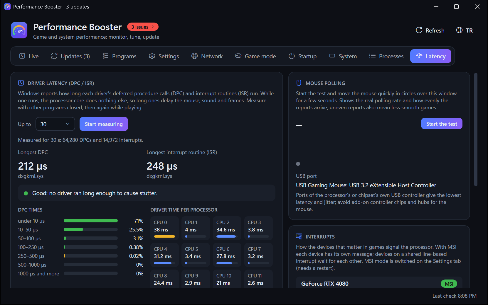
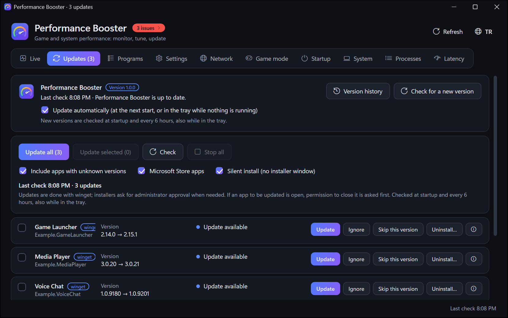
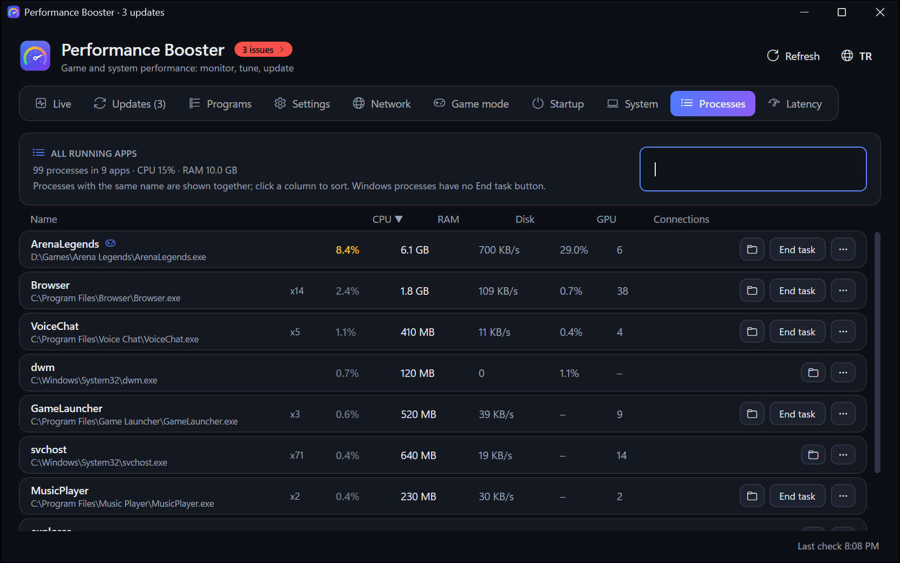
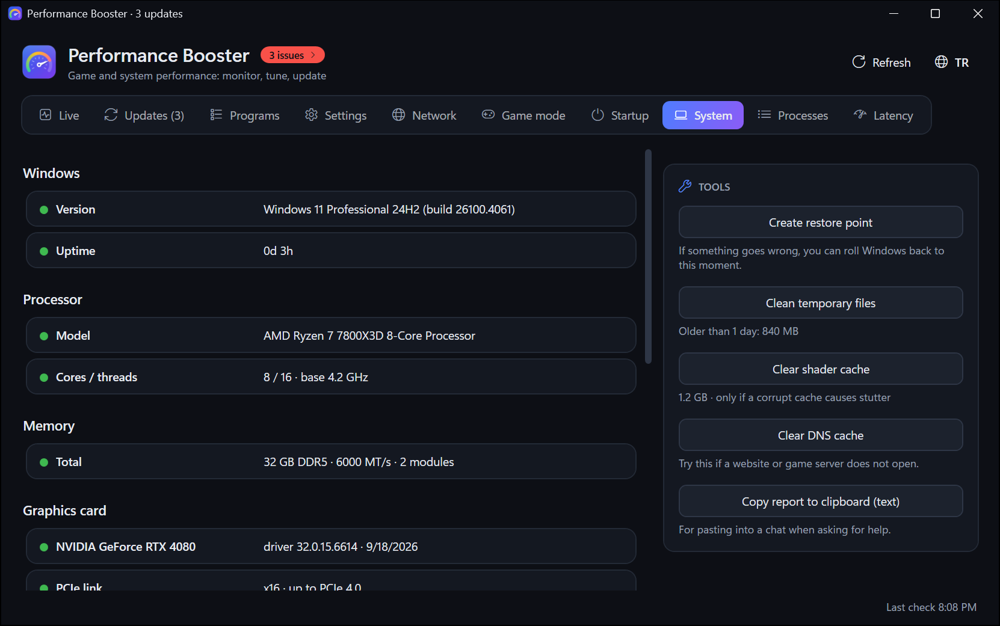

<div align="center">


# Performance Booster

**Windows için oyun ve sistem performansı: izle, ayarla, güncelle.**

[](#gereksinimler)
[](#indir)
[](#diller)

<a href="https://github.com/AtaolB/Performance-Booster/releases/latest/download/PerformanceBooster.exe"></a>

<sub>Tek dosya · kendini günceller · [tüm sürümler](https://github.com/AtaolB/Performance-Booster/releases) · [neler yeni](CHANGELOG.tr.md)</sub>

[English](README.md) · **Türkçe**

<br>



</div>

## Neden Performance Booster

- **Oyunların nasıl çalıştığını etkileyen her şey tek pencerede:** anlık kullanım, Windows ayarları, sürücü ve uygulama güncellemeleri, ağ kalitesi, giriş gecikmesi.
- **Her değişiklik geri alınabilir.** Bir ayar ilk kez değiştirilmeden önce eski değeri kaydedilir; Geri al onu geri koyar. Toplu değişikliklerden önce geri yükleme noktası oluşturulur.
- **Tahmin etmez, açıklar.** Her ayar ne yaptığını, neye mal olduğunu ve önerilen değeri söyler; sorunlar Düzelt düğmesiyle gelir.
- **Küçük.** Kendini güncel tutan ~2 MB'lık tek bir exe.

## Özellikler

| | |
|---|---|
| **Canlı** | Genel bakış: 60 saniyelik grafiklerle işlemci, RAM, ekran kartı, disk ve ağ; modeme ve kullanılan DNS sunucusuna ping, dalgalanma ve kayıp; düzeltmeleriyle sorunlar paneli (üstteki sorun sayısına tıklayınca açılır). Bir karta tıklayınca o kaynağı en çok kullanan uygulamalar görünür, uygulama başına ağ trafiği dahil. |
| **İşlemler** | Çalışan tüm uygulamalar; işlemci, RAM, disk, ekran kartı ve bağlantı sayısıyla. Sıralamak için sütuna tıkla, ara ya da görevi sonlandır. Bir satıra sağ tıklayınca (ya da ⋯) önceliğini değiştir, oyun listesine ekle, oyun açıkken tam hızda tut ya da dosya konumunu aç. |
| **Güncellemeler** | winget ile uygulama güncellemeleri (sabitle, sürümü atla, ayrıntılar); açık uygulamalar yalnızca iznini alarak kapatılır. Güncellemeleri tek tek ya da hepsini birden iptal et. Windows Update ile sürücü güncellemeleri; Denetle ikisine de bakar. |
| **Programlar** | Boyutu, kurulum tarihi ve son kullanımıyla masaüstü programları ve Store uygulamaları; sıralamak için sütuna tıkla. Mümkünse sessiz kaldırma, artık taraması (dosyalar Geri Dönüşüm Kutusu'na gider, kayıt defteri anahtarları önce yedeklenir) ve dosyaları zaten silinmiş bozuk kayıtların kaldırılması. |
| **Ayarlar** | Güç, grafik, zamanlama, bellek, giriş, ağ ve ağ bağdaştırıcısı ayarları, NVIDIA sürücü seçenekleri, MSI modu, cihaz güç tasarrufu, kullanılmayan cihazlar ve nadiren gereken hizmetler. Her biri şu anki ve önerilen değeri, etkisi ve geri alma seçeneğiyle; tam açıklama için satırın üzerine gel, aradığını arama kutusuyla bul. |
| **Oyun modu** | Bir oyun açıkken (listendeki, çalışan uygulamalardan ya da exe dosyasından eklenen bir oyun veya Windows'un kendisinin oyun olarak tanıdığı bir oyun): oyunlar için güç planı, isteğe bağlı olarak oyuna yüksek öncelik, diğer uygulamalar düşük öncelik ve verimlilik modunda ve oyunun çekirdeklerinden uzakta (tam hızda tuttukların hariç), bellek azalınca bekleme listesinin boşaltılması, Wi-Fi ağ aramasının duraklatılması. İki ekran kartında oyunlar yüksek performanslı kartta çalışır. Her oyundan sonra Son oyun kartı oyunu neyin kısıtladığını gösterir: ısı ya da güç sınırı, dolan ekran belleği, azalan RAM ya da pil gücü. Oyunlar Defender'ın gerçek zamanlı taramasından çıkarılabilir. Uygulama çalıştığı sürece daha hassas bir Windows zamanlayıcısı tutulur. |
| **Gecikme** | Sürücü gecikmesi (sürücü ve işlemci çekirdeği başına DPC ve ISR süreleri), farenin bağlı olduğu USB denetleyicisiyle birlikte fare yoklama testi ve oyunlarda önemli cihazların kesmeleri. |
| **Ağ** | 10, 30 veya 60 saniyelik, yük altında gecikmeyle hız testi (bufferbloat notu) ve normal ile şifreli (HTTPS üzerinden DNS) ölçen, sağlayıcının DNS yönlendirmesini de fark eden DNS hız testi; daha hızlı DNS sunucusuna tek tıkla geçiş, Windows 11'de şifreli. |
| **Başlangıç · Sistem** | Başlangıç öğeleri, ipuçlarıyla donanım ayrıntıları (ekran kartının PCIe hatları, Resizable BAR, HDD'de ya da neredeyse dolu sürücüdeki oyunlar) ve temizlik araçları. |

<details>
<summary><b>Ekran görüntüleri</b></summary>
<br>

| Canlı | Ayarlar |
|---|---|
|  |  |
| **Oyun modu** | **Ağ** |
|  |  |
| **Gecikme** | **Güncellemeler** |
|  |  |
| **İşlemler** | **Sistem** |
|  |  |

</details>

## İndir

1. Son sürümden **[PerformanceBooster.exe](https://github.com/AtaolB/Performance-Booster/releases/latest/download/PerformanceBooster.exe)** dosyasını indir ve kendine ait bir klasöre koy (örneğin `Belgeler\PerformanceBooster`).
2. Çalıştır. Windows bir kez yönetici izni ister: uygulama sistem ayarlarını, hizmetleri ve cihazları değiştirir.
3. **Canlı** sekmesi o an neler olduğunu gösterir; **Ayarlar** sekmesi her ayarı önerilen değeriyle listeler.

Yeni sürümler kendiliğinden kurulur (bir sonraki açılışta ya da uygulama tepsideyken). Güncellemeden sonra uygulama nelerin değiştiğini gösterir.

### Gereksinimler

- Windows 10 sürüm 1903 veya sonrası ya da Windows 11 (64 bit).

### Diller

Türkçe ve İngilizce. Uygulama Windows'un görüntüleme dilini izler; dil düğmesiyle değiştirilebilir.

## Güvenlik ve gizlilik

- **Geri alma:** her ayar özgün değerini saklar; Ayarlar sekmesi bir ya da tüm değişiklikleri geri alır. Toplu değişikliklerden önce geri yükleme noktası oluşturulur.
- **Hiçbir şey kalıcı olarak silinmez:** artık dosyalar Geri Dönüşüm Kutusu'na gider, kayıt defteri anahtarları silinmeden önce `.reg` dosyasına aktarılır.
- **Hesap yok, telemetri yok.** Uygulama yalnızca gördüğün işler için bağlanır: güncelleme denetimleri (GitHub, winget, Windows Update), Canlı sekmesindeki ping hedefleri ve sen başlattığında hız ve DNS testleri.
- **Verilerin bilgisayarında kalır:** `%LOCALAPPDATA%\PerformanceBooster`.

## Sık sorulanlar

<details>
<summary><b>Windows "Bilgisayarınız Windows tarafından korundu" diyor. Güvenli mi?</b></summary>

Exe kod imzalı değil, bu yüzden SmartScreen onu henüz tanımıyor. **Ek bilgi → Yine de çalıştır**'a tıkla. Karşılaştırmak istersen her sürüm sayfasında exe'nin SHA-256 değeri yazar.
</details>

<details>
<summary><b>Neden yönetici izni gerekiyor?</b></summary>

Güç planlarını, hizmetleri, cihazları, sürücüleri ve oyun ayarlarının çoğunu yalnızca yönetici değiştirebilir. Uygulama her değişiklik için ayrı ayrı sormamak için yönetici olarak çalışır.
</details>

<details>
<summary><b>Her şeyi nasıl geri alırım?</b></summary>

Ayarlar sekmesi → **Tümünü geri al**. Ayarları tek tek de geri alabilir ya da toplu değişikliklerden önce oluşturulan geri yükleme noktasına dönebilirsin (Sistem sekmesi → Geri yükleme noktası oluştur / Windows Sistem Geri Yükleme).
</details>

<details>
<summary><b>Güncellemeler nasıl çalışır?</b></summary>

Uygulama açılışta ve 6 saatte bir yeni sürüm olup olmadığına bakar ve yeni sürümü arka planda indirir. Yeni sürüm bir sonraki açılışta, **Yeniden başlat ve güncelle**'ye tıklayınca ya da uygulama tepsideyken hiçbir işlem sürmüyorsa kurulur. Elle güncellemeyi tercih edersen Güncellemeler sekmesinden kapat.
</details>

<details>
<summary><b>Uygulamayı nasıl kaldırırım?</b></summary>

Önce Oyun modu sekmesinde **Windows açılınca tepside başlat** ve **RAM temizliği** seçeneklerini kapat (ikisi de zamanlanmış görev kullanır), geri istediğin ayarları geri al, sonra exe'yi ve `%LOCALAPPDATA%\PerformanceBooster` klasörünü sil.
</details>

## Sürüm geçmişi

Her sürüm ve getirdikleri: [CHANGELOG.tr.md](CHANGELOG.tr.md).

---

## Geliştiriciler için

<details>
<summary><b>Derleme, test, yayın</b></summary>
<br>

Gereksinimler: Windows 10/11 ve [.NET 10 SDK](https://dotnet.microsoft.com/download).

```powershell
dotnet build PerformanceBooster.slnx -c Debug
dotnet run --project PerformanceBooster.Tests -- [--no-net] [--only Section]
dotnet publish PerformanceBooster.Launcher -c Release -o out   # out\PerformanceBooster.exe, yönetici olarak çalışır
```

`dotnet publish PerformanceBooster.Launcher` yayınlanan exe'yi derler; uygulama onun içinde paketlenir. Yayın iş akışı `-p:PublishAot=true` ekler (Visual Studio'nun C++ derleme araçlarını ister).

Test bölümleri: Localization, Engine, Updates, AppUpdate, Changelog, System, GameBoost, Latency, Network, Programs, Details, App. Testler gerçek sistem ayarlarını hiç değiştirmez: sahte depolar, `HKCU\Software\PerformanceBoosterTests` altında geçici kayıt defteri anahtarları, geçici klasörler ve sahte işlemler kullanır. `PERFORMANCEBOOSTER_DATA` uygulamayı ayrı bir veri klasörüne yönlendirir.

**Yayınlama:** `main`'e giren her değişiklik `PerformanceBooster/PerformanceBooster.csproj` içindeki `<Version>` değerini artırır ve notlarını hem [CHANGELOG.md](CHANGELOG.md) hem [CHANGELOG.tr.md](CHANGELOG.tr.md) dosyasının en üstüne ekler (Changelog testleri bunu denetler). Yayını olmayan bir sürüm `main`'e gelince [yayın iş akışı](.github/workflows/release.yml) testleri çalıştırır, exe'yi derler ve bu notlarla `v<sürüm>` yayınlar. Çalışan kopyalar onu bulup kendini günceller.

| Yol | İçerik |
|---|---|
| `PerformanceBooster/Core` | Ayar motoru, ölçüm, winget, Windows Update, programlar, kaldırıcı, ağ testleri, gecikme izleme, kendi kendini güncelleme, sürüm notları |
| `PerformanceBooster/UI` | Görünüm modelleri, satırlar, iletişim kutuları, tepsi |
| `PerformanceBooster/Languages` | Arayüz dilleri (`en.json`, `tr.json`), exe'nin içinde; koddaki İngilizce metin anahtardır |
| `PerformanceBooster.Launcher` | Yayınlanan exe; uygulama içinde paketlenmiş |
| `PerformanceBooster.Tests` | Test çalıştırıcı |
| `docs` | Ekran görüntüleri ve tanıtım animasyonu |

</details>
